# Nori施術院 01 v14 構成・台本
55秒・20カット・無音の静止画編集。読み上げ欄は収録前の案。
実景以外はAI生成イメージ。手技は先生による確認用。効果実証・実際の体験談ではない。

## 01｜0–2.8秒
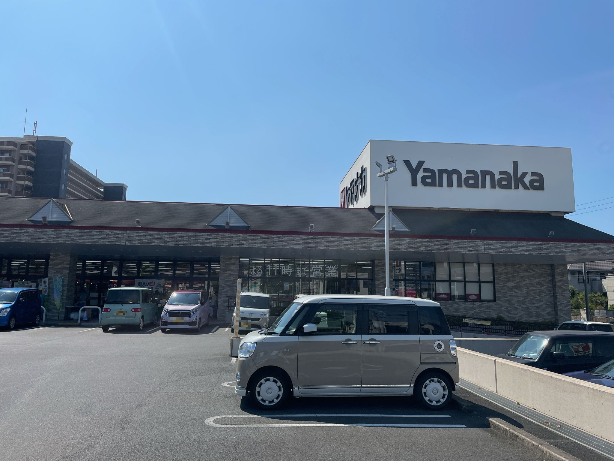
- テロップ：お近くにお住まいの方へ
- 読み上げ案：お近くにお住まいの方へ
- 演出：提供されたヤマナカ知多店の写真。地域の呼びかけ。

## 02｜2.8–3.9秒
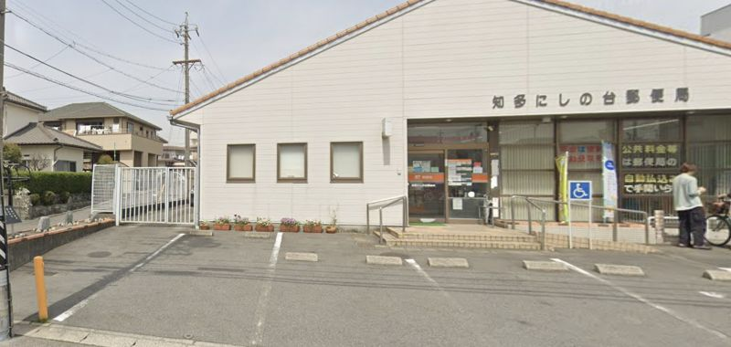
- テロップ：ヤマナカ知多店から、すぐ近くへ。
- 読み上げ案：ヤマナカ知多店から、すぐ近くへ。
- 演出：Googleストリートビュー。前方へズーム。

## 03｜3.9–4.9秒
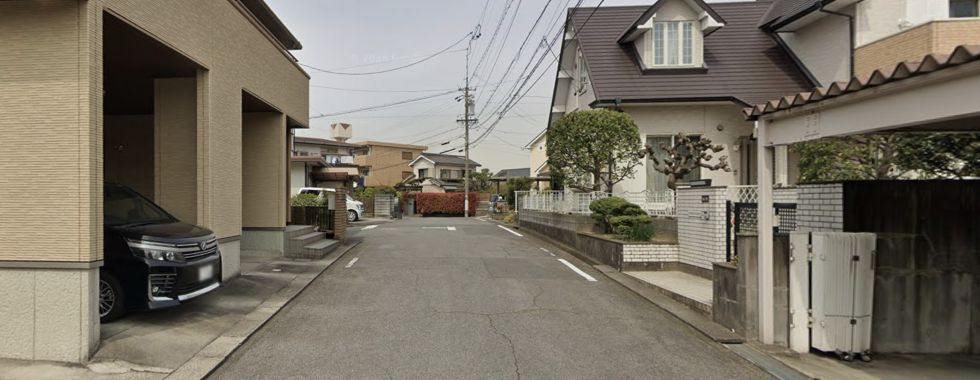
- テロップ：ヤマナカ知多店から、すぐ近くへ。
- 読み上げ案：ヤマナカ知多店から、すぐ近くへ。
- 演出：Googleストリートビュー。次の地点へ短くカット。

## 04｜4.9–6.2秒
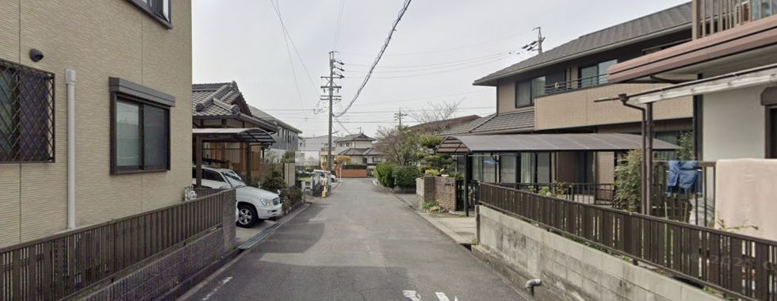
- テロップ：ヤマナカ知多店から、すぐ近くへ。
- 読み上げ案：ヤマナカ知多店から、すぐ近くへ。
- 演出：Googleストリートビュー。住宅街から院内へ。

## 05｜6.2–11秒
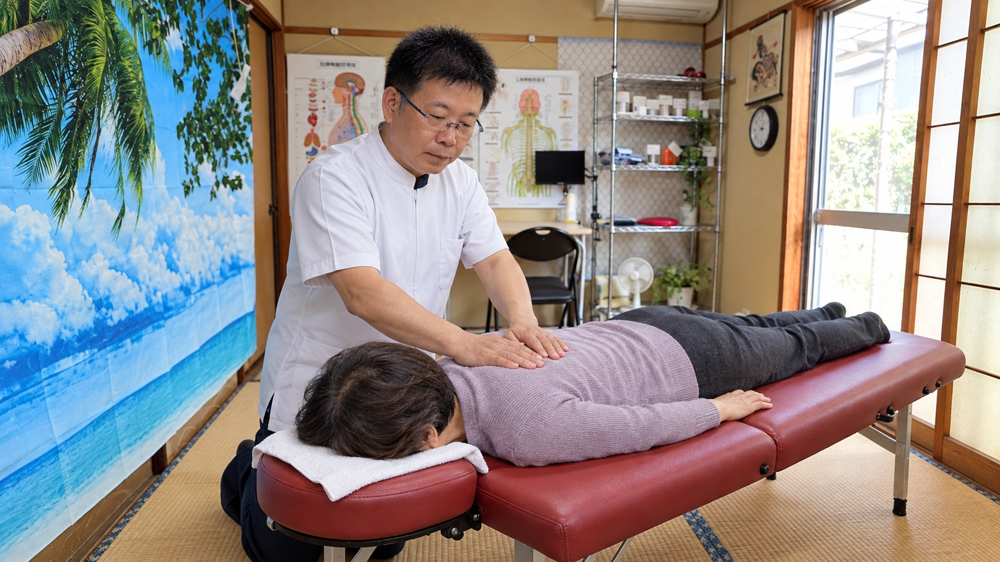
- テロップ：肩こり・腰のつらさを、近くで相談。
- 読み上げ案：肩こり・腰のつらさを、近くで相談。
- 演出：顔写真の右配置を削除。先生の施術シーンを全面で見せる。

## 06｜11–14秒

- テロップ：買い物や家事で、腰がつらい。
- 読み上げ案：買い物や家事で、腰がつらい。
- 演出：買い物後の腰のつらさを日常の動作で表現。

## 07｜14–17秒
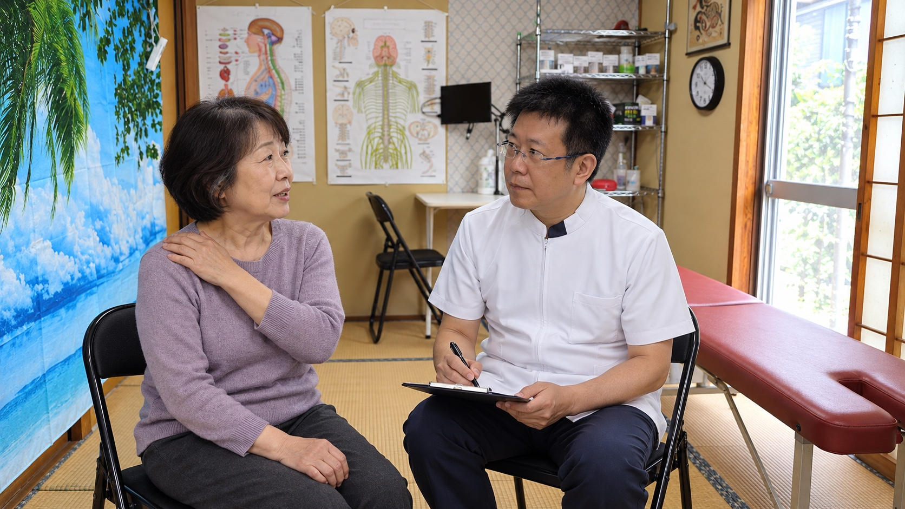
- テロップ：肩こりも、がまんしていませんか。
- 読み上げ案：肩こりも、がまんしていませんか。
- 演出：肩を指しながら相談。先生が向き合って聞く。

## 08｜17–19秒

- テロップ：いつ、どんな動きがつらいか。
- 読み上げ案：いつ、どんな動きがつらいか。
- 演出：同じ相談の中で先生の表情に寄る。

## 09｜19–23秒
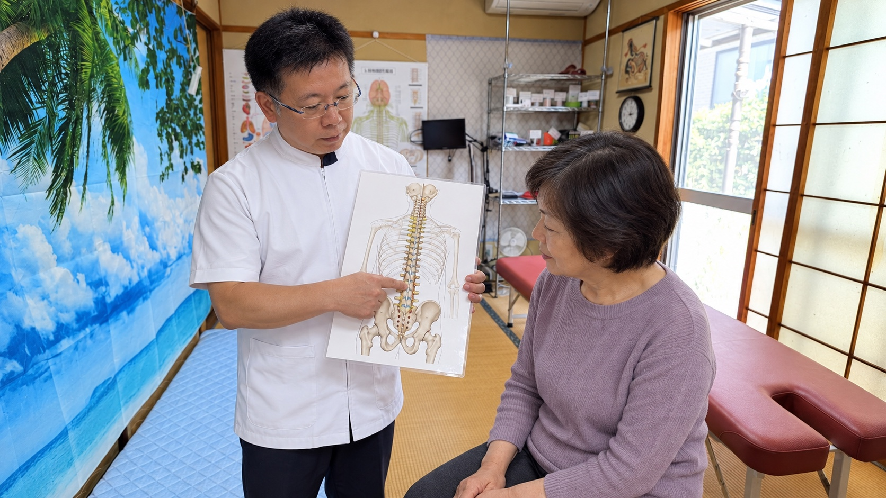
- テロップ：体の状態を、図を使ってご説明。
- 読み上げ案：体の状態を、図を使ってご説明。
- 演出：先生が背骨・骨盤の図を指して説明。装飾だけの図解は使わない。

## 10｜23–26秒
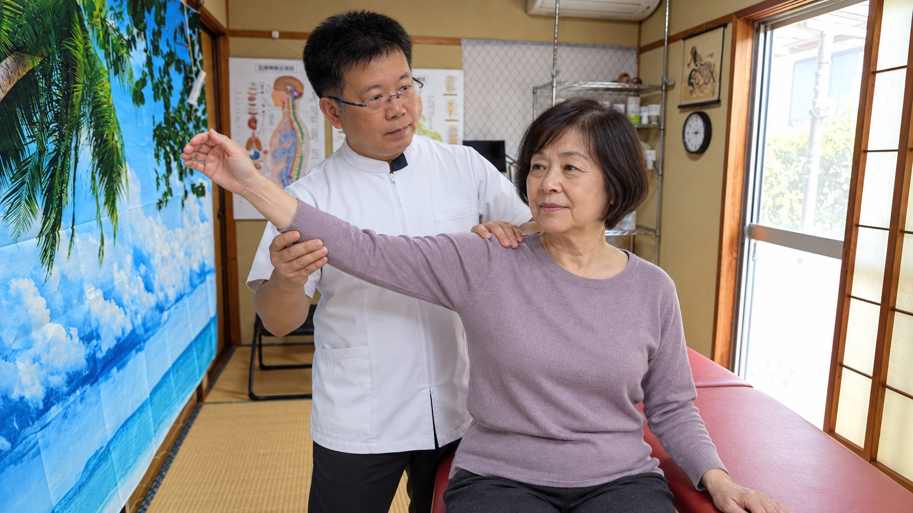
- テロップ：動かしやすさを、一緒に確認。
- 読み上げ案：動かしやすさを、一緒に確認。
- 演出：肩・腕の動きの確認。

## 11｜26–28.5秒

- テロップ：背中まわりを、手で丁寧に。
- 読み上げ案：背中まわりを、手で丁寧に。
- 演出：うつ伏せで背中まわりの手技。

## 12｜28.5–30秒

- テロップ：背中まわりを、手で丁寧に。
- 読み上げ案：背中まわりを、手で丁寧に。
- 演出：背中の手元に寄り、短くカット。

## 13｜30–33秒
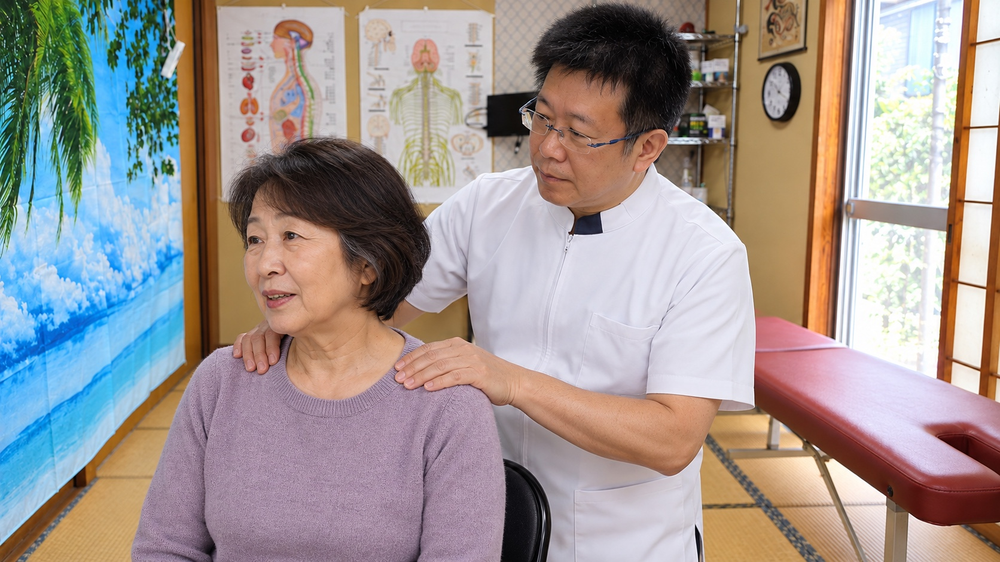
- テロップ：肩まわりにも、丁寧に触れて。
- 読み上げ案：肩まわりにも、丁寧に触れて。
- 演出：座った姿勢で肩まわりを確認する手技。

## 14｜33–35.5秒
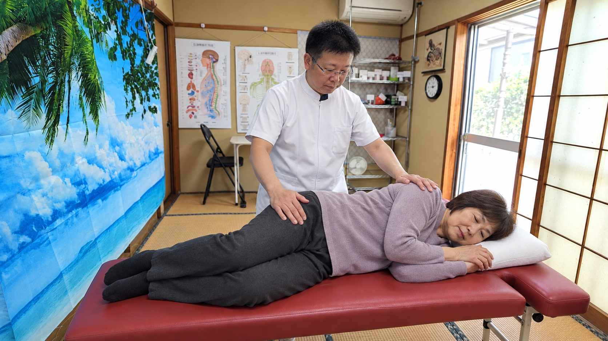
- テロップ：骨盤まわりも、状態を見ながら。
- 読み上げ案：骨盤まわりも、状態を見ながら。
- 演出：横向きで骨盤まわりの状態を見る。

## 15｜35.5–37秒

- テロップ：骨盤まわりも、状態を見ながら。
- 読み上げ案：骨盤まわりも、状態を見ながら。
- 演出：横向きの手の位置に寄る。

## 16｜37–40秒

- テロップ：施術のあとも、動きを確認。
- 読み上げ案：施術のあとも、動きを確認。
- 演出：施術後の動きを一緒に確認。改善量や数値は表示しない。

## 17｜40–42秒

- テロップ：その日の体のこと、気軽に相談。
- 読み上げ案：その日の体のこと、気軽に相談。
- 演出：最後に気になる点を確認する会話。

## 18｜42–47秒
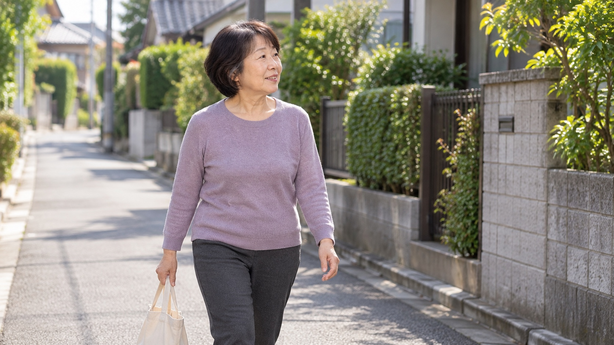
- テロップ：毎日を、少しでも軽やかに。
- 読み上げ案：毎日を、少しでも軽やかに。
- 演出：穏やかな表情で帰る日常イメージ。実際の体験談・効果実証ではない。

## 19｜47–50秒

- テロップ：肩こり・腰のつらさ、ご相談ください。
- 読み上げ案：肩こり・腰のつらさ、ご相談ください。
- 演出：検索語・電話番号・住所を表示。背景も施術シーン。

## 20｜50–55秒

- テロップ：肩こり・腰のつらさ、ご相談ください。
- 読み上げ案：肩こり・腰のつらさ、ご相談ください。
- 演出：CTAを保持。電話番号を読む時間を確保。
