# 02 アニメ版・構成と台本 V16

添付見本準拠：温かな光・明瞭な輪郭・手描き背景の2Dアニメ

52秒・17カット。旧02-06〜08を削除。元番号を維持。03の体験談は変更なし。

## 02-01｜00–02秒｜ヤマナカ知多店・買い物帰り

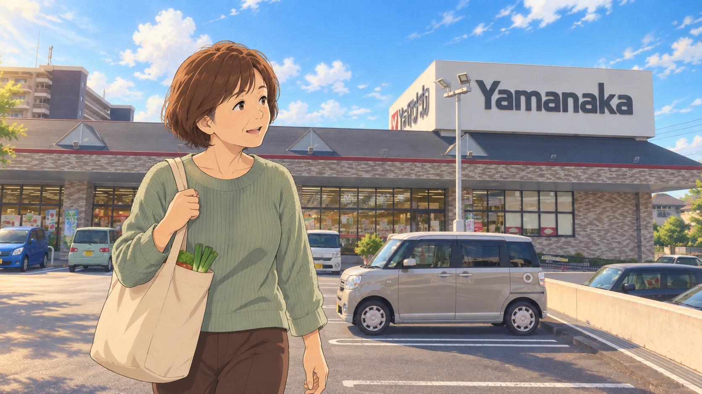

テロップ：にしの台の、いつもの帰り道。

読み上げ：にしの台の、いつもの帰り道。

演出：提供された店舗写真を参考に描いたスーパー前。主人公の生活圏から導入。

備考：スーパー外観は提供写真を参考に描画。背景の細部はアニメ表現。

## 02-02｜02–04秒｜買い物袋と肩を気にする主人公

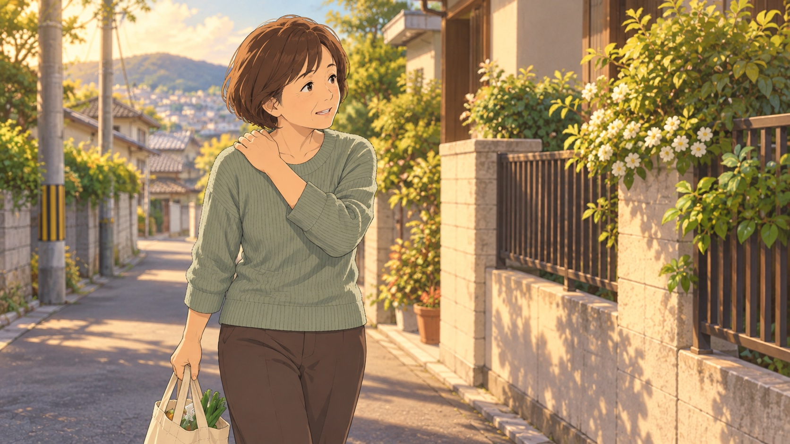

テロップ：その荷物、肩にきていませんか。

読み上げ：買い物袋が、肩にこたえる。

演出：買い物袋を持つ主人公の中景。肩に手を添え、日常のつらさを表す。

備考：人物と場面はアニメによるイメージ。先生の顔写真を参照し、見本の線・色・光で統一。

## 02-03｜04–06秒｜肩を気にする表情・寄り

テロップ：その荷物、肩にきていませんか。〈継続〉

読み上げ：―

演出：直前の絵を肩と表情へ寄せる。同じテロップを継続。

備考：人物と場面はアニメによるイメージ。先生の顔写真を参照し、見本の線・色・光で統一。

## 02-04｜06–09秒｜帰宅して袋を台へ置く・中景

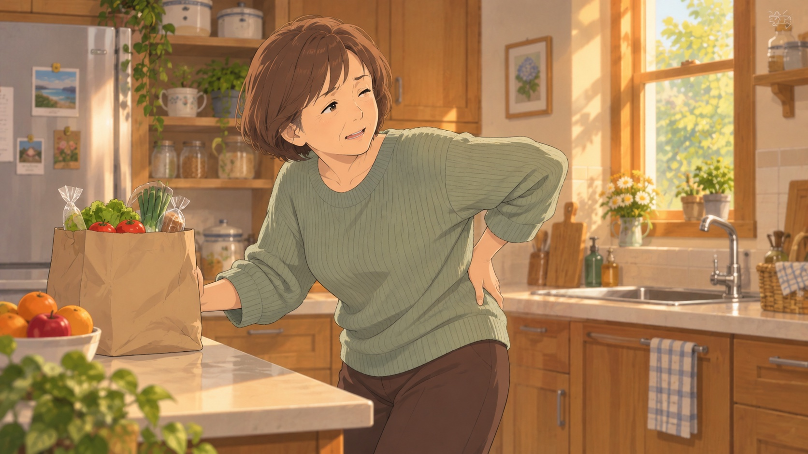

テロップ：腰まで、気になる。

読み上げ：家に着いても、腰が気になる。

演出：袋を持ち上げる途中で動作を止める。腰に片手、もう片手は台へ。

備考：人物と場面はアニメによるイメージ。先生の顔写真を参照し、見本の線・色・光で統一。

## 02-05｜09–12秒｜食卓に座る主人公

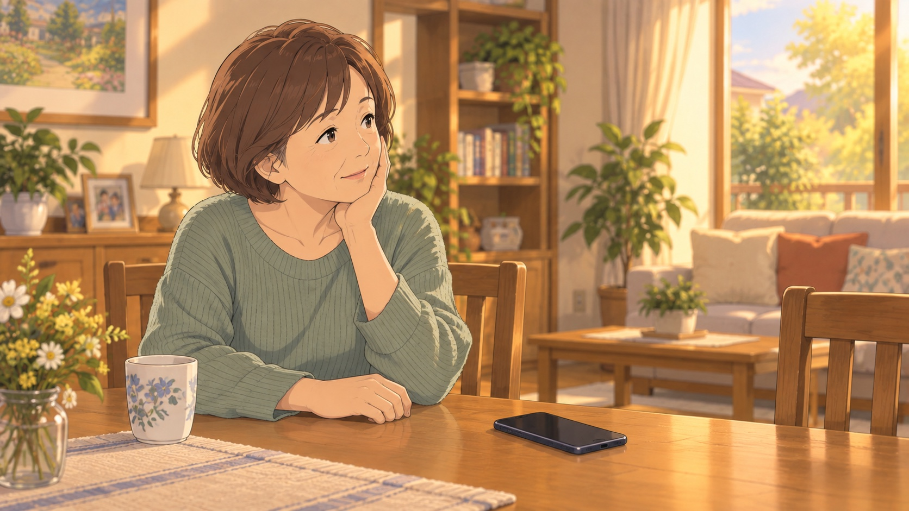

テロップ：どこに相談したらいい？

読み上げ：どこに相談したらいいんだろう。

演出：スマートフォンを前に「どこに相談しよう」と考える。

備考：人物と場面はアニメによるイメージ。先生の顔写真を参照し、見本の線・色・光で統一。

## 02-09｜12–15秒｜院内で前田先生が迎える

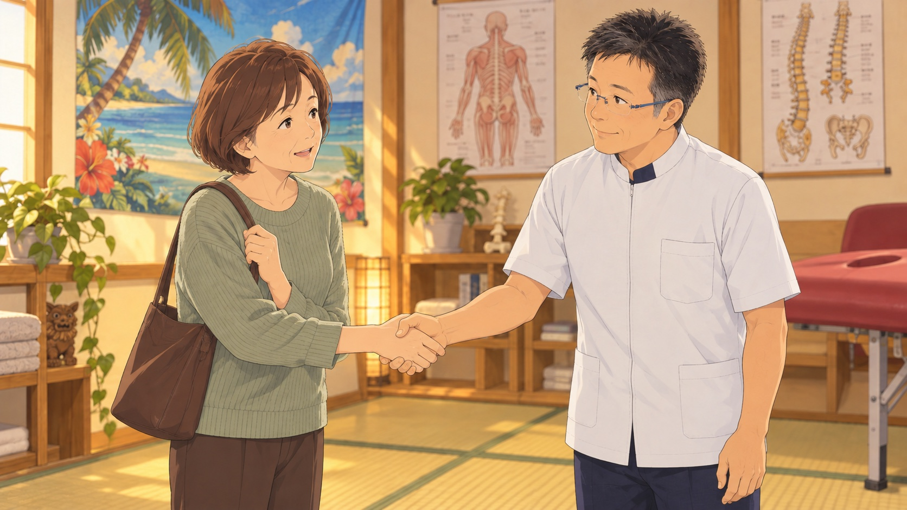

テロップ：にしの台のNori施術院で、相談。

読み上げ：にしの台のNori施術院へ。

演出：悩む食卓から院内の歓迎場面へ直接切り替え、相談先を紹介。

備考：人物と場面はアニメによるイメージ。先生の顔写真を参照し、見本の線・色・光で統一。

## 02-10｜15–18秒｜院内で対面の会話

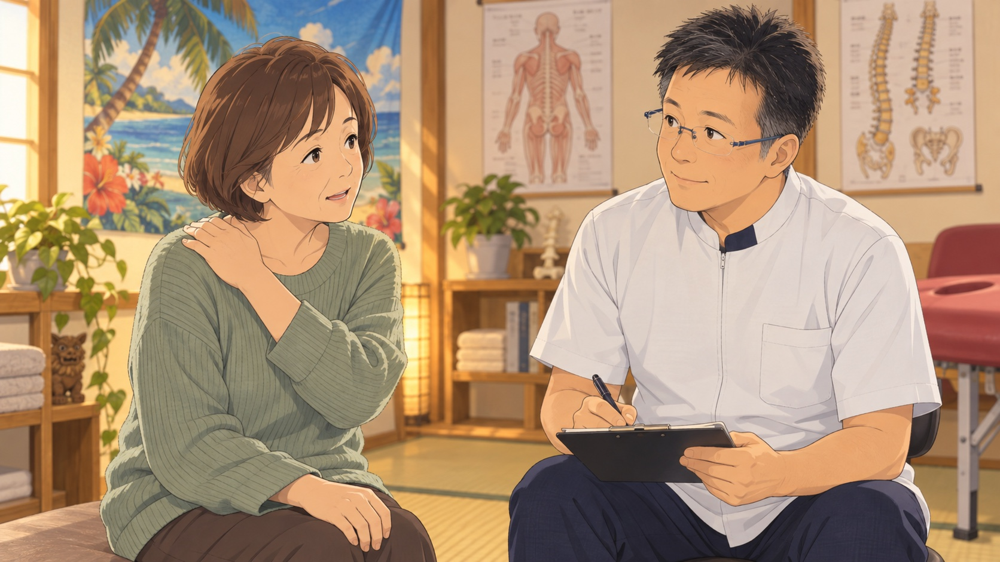

テロップ：「買い物のあと、肩や腰が…」

読み上げ：「買い物のあと、肩や腰が気になって」

演出：主人公と先生の二人を見せ、買い物中の肩・腰の悩みを話す。

備考：人物と場面はアニメによるイメージ。先生の顔写真を参照し、見本の線・色・光で統一。

## 02-11｜18–21秒｜話を聞く先生・寄り

テロップ：困っている場面を、お聞かせください。

読み上げ：困っている場面から、お話しください。

演出：対面場面から先生の表情へ寄る。目線を相手に合わせて聞く。

備考：人物と場面はアニメによるイメージ。先生の顔写真を参照し、見本の線・色・光で統一。

## 02-12｜21–24秒｜肩・腕の動きを確認

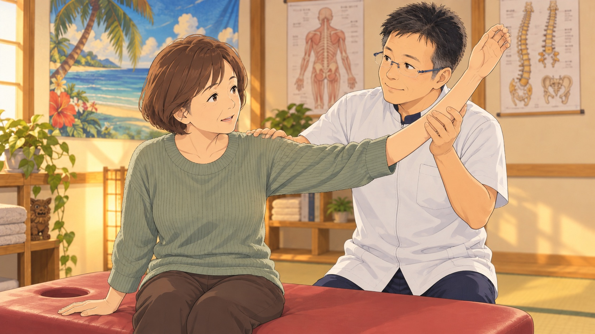

テロップ：姿勢や動きを確認

読み上げ：姿勢や動きを確認して、

演出：先生が腕を支えて動きを確認。数値判定や矯正の効果を示す図は入れない。

備考：人物と場面はアニメによるイメージ。先生の顔写真を参照し、見本の線・色・光で統一。

## 02-13｜24–27秒｜先生が図を手に説明

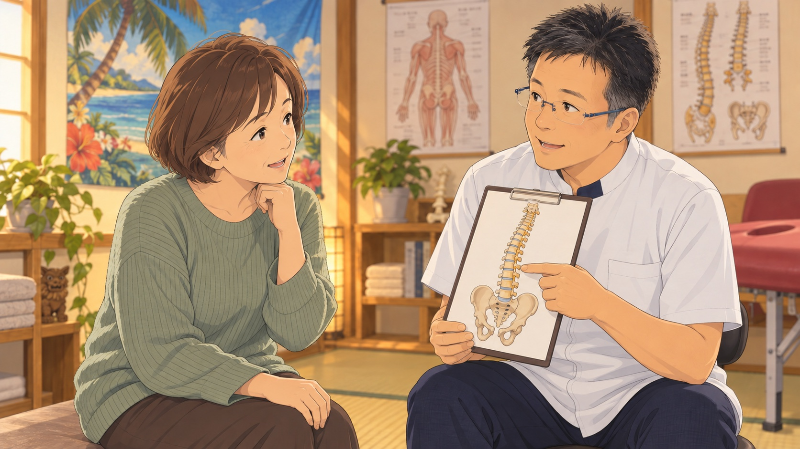

テロップ：骨盤・背骨を中心に

読み上げ：骨盤や背骨を中心にケアします。

演出：先生が手元の背骨・骨盤の図を指し、対話しながら説明。独立した図解画面は挟まない。

備考：人物と場面はアニメによるイメージ。先生の顔写真を参照し、見本の線・色・光で統一。

## 02-14｜27–30秒｜背中のケア・全体

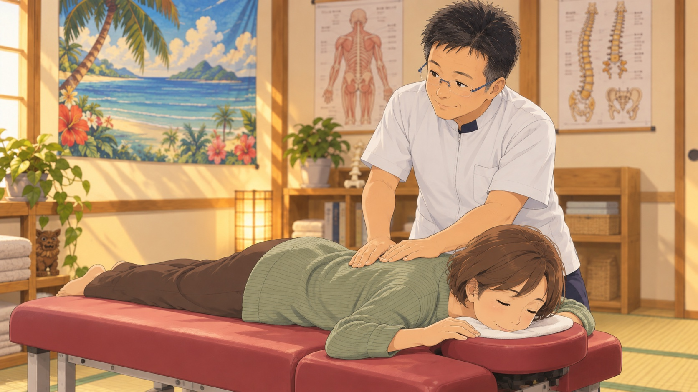

テロップ：手技によるケア

読み上げ：―

演出：うつ伏せの主人公の背部へ先生が両手を添える。施術イメージ。

備考：施術イメージ。実際の触れ方・実施内容は先生との確認対象。

## 02-15｜30–33秒｜施術する両手と表情・寄り

テロップ：気になることも、話しながら。

読み上げ：気になることも、話しながら。

演出：直前の絵を先生の両手と主人公の横顔へ寄せる。

備考：施術イメージ。実際の触れ方・実施内容は先生との確認対象。

## 02-16｜33–36秒｜体の状態を一緒に確認

テロップ：体の状態を、一緒に確認。

読み上げ：体の状態を、一緒に確認します。

演出：肩・腕の確認場面へ戻り、主人公の感覚を聞く。改善値の比較は入れない。

備考：人物と場面はアニメによるイメージ。先生の顔写真を参照し、見本の線・色・光で統一。

## 02-17｜36–39秒｜大切にしたい日常・友人と散歩

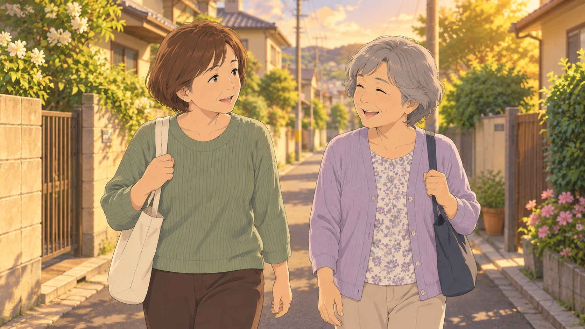

テロップ：いつもの毎日を、大切にしたい。

読み上げ：いつもの毎日を、大切にしたい。

演出：友人と会話しながら歩く日常のイメージ。治療前後の証明映像にはしない。

備考：日常のイメージ。実在患者の改善体験談ではありません。

## 02-18｜39–42秒｜視聴者への案内・電話の手元

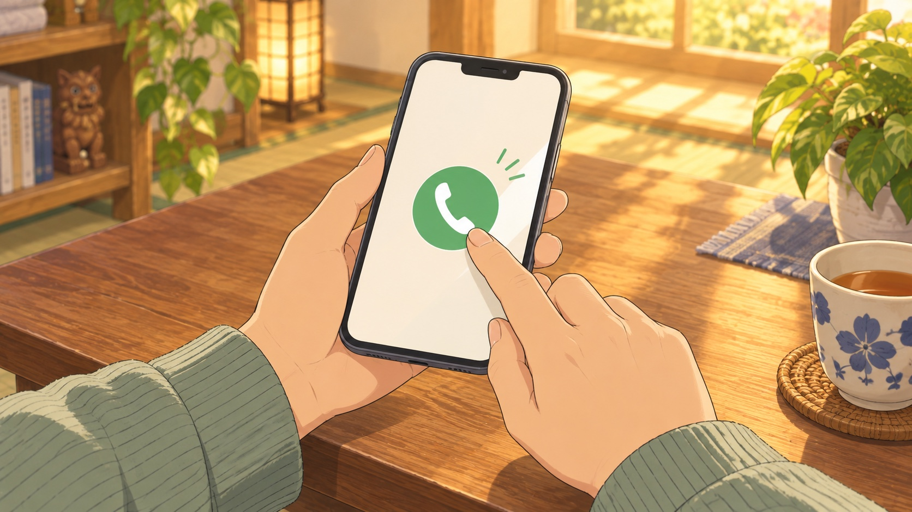

テロップ：まずは、肩・腰のご相談から。

読み上げ：まずは、肩や腰のご相談から。

演出：主人公の物語から予約案内へ切り替える。手元と電話アイコンにして、受診後に初回予約をする時系列に見せない。

備考：人物と場面はアニメによるイメージ。先生の顔写真を参照し、見本の線・色・光で統一。

## 02-19｜42–44秒｜先生と地域名を並べた画面

テロップ：Nori施術院｜知多市にしの台

読み上げ：Nori施術院へ。

演出：主人公から先生へ視線をつなぎ、院名を大きく置く。

備考：人物と場面はアニメによるイメージ。先生の顔写真を参照し、見本の線・色・光で統一。

## 02-20｜44–52秒｜アニメの先生＋電話CTA

テロップ：090-3386-2986

読み上げ：「肩や腰の相談をしたい」と、お電話ください。

演出：先生を右、院名・電話・住所を左に配置。8秒保持して読む時間を確保。

備考：人物と場面はアニメによるイメージ。先生の顔写真を参照し、見本の線・色・光で統一。

## 通し読み

にしの台の、いつもの帰り道。買い物袋が、肩にこたえる。家に着いても、腰が気になる。どこに相談したらいいんだろう。にしの台のNori施術院へ。「買い物のあと、肩や腰が気になって」困っている場面から、お話しください。姿勢や動きを確認して、骨盤や背骨を中心にケアします。気になることも、話しながら。体の状態を、一緒に確認します。いつもの毎日を、大切にしたい。まずは、肩や腰のご相談から。Nori施術院へ。「肩や腰の相談をしたい」と、お電話ください。
