# 03 先生の体験談｜画像付き構成 V17

80秒・20カット。体験談・テロップ・読み上げ・尺は従来通り。絵柄を02と統一。

## 03-01｜00–03秒｜現在の前田先生・正面寄り

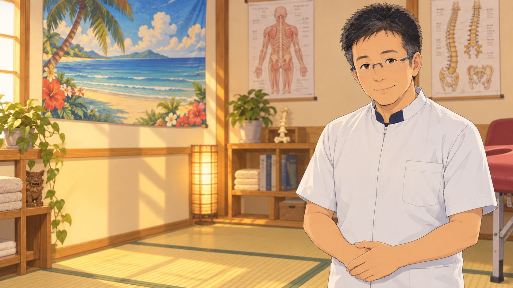

テロップ：私も、受ける側でした。

読み上げ：私も、最初は施術を受ける側でした。

演出：提供写真に合わせた先生が院内で語り始める。字幕は引用扱いでなく語り案。

根拠・確認：先生の語り案・本人確認前。会議28:12〜28:35。

## 03-02｜03–06秒｜私服の先生・肩に手

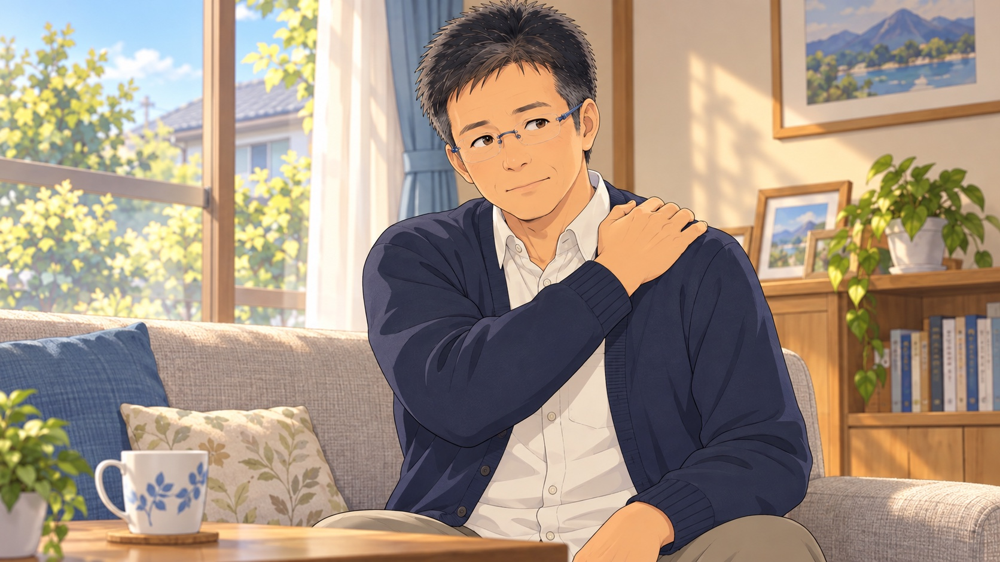

テロップ：きっかけは、肩こり。

読み上げ：きっかけは、肩こりです。

演出：過去の場面へ色温度を少し落として切替。先生を別の若い人物にしない。

根拠・確認：会議35:15〜36:01。症状の期間や重症度は加えない。

## 03-03｜06–10秒｜自宅で相談先を調べる手元

テロップ：相談先を探す中で

読み上げ：相談先を探す中で、

演出：検索する先生。実在しない病院名や診断結果を出さない。

根拠・確認：会議35:20〜36:01。病院へ通っても治らなかった話にはしない。

## 03-04｜10–14秒｜初めて施術院へ向かう過去の先生

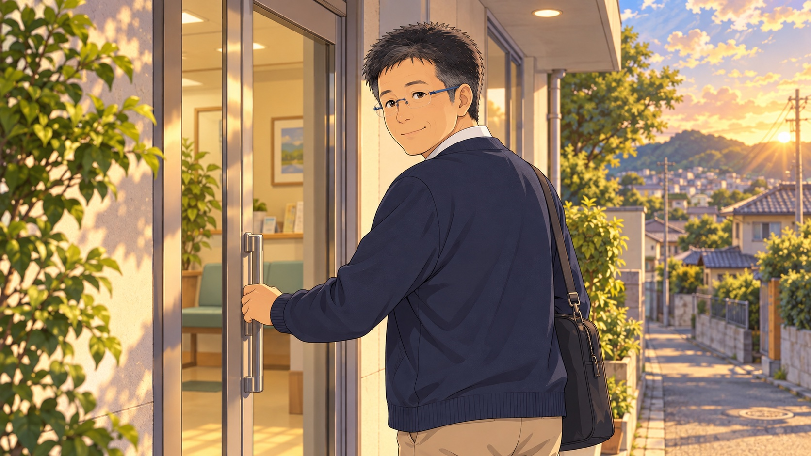

テロップ：カイロプラクティックと出会う。

読み上げ：カイロプラクティックに出会いました。

演出：再現用の一般的な入口。現在のNori院への来院と誤認させない。

根拠・確認：出会った施術院は再現イメージ。会議35:20〜36:01。

## 03-05｜14–18秒｜施術を受ける過去の先生

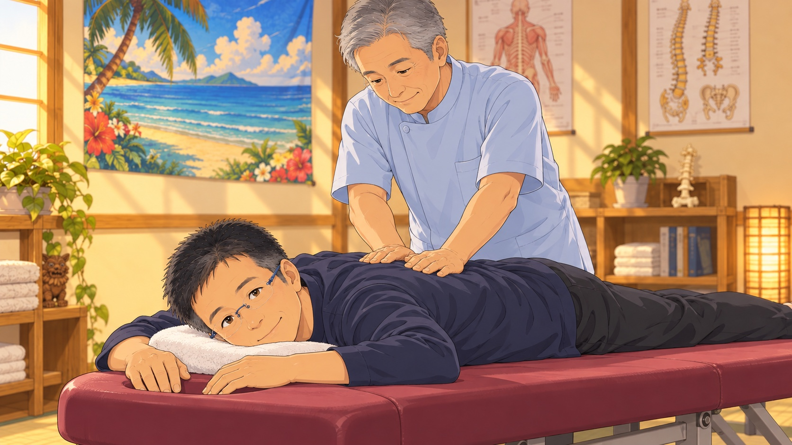

テロップ：通う中で、知った技術。

読み上げ：施術を受けて、通うようになりました。

演出：受け手としてベッドに横になる先生。担当施術者は架空の別人。

根拠・確認：会議28:35。肩こりが完治した描写は記録にない。

## 03-06｜18–22秒｜相談中の二人・中景

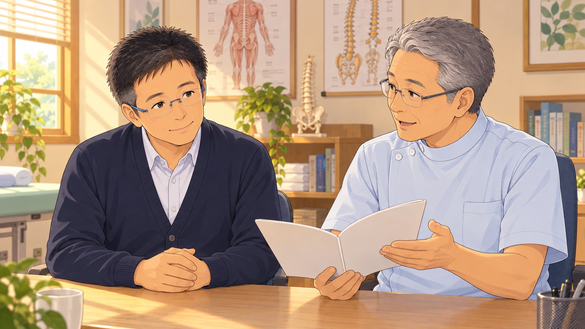

テロップ：先生から、学びの勧め。

読み上げ：通っていた先生から、学びを勧められました。

演出：先輩の先生が学びの資料を見せる。セリフの直接引用はしない。

根拠・確認：会議28:35。「やった方がいいよ」という内容を要約。

## 03-07｜22–26秒｜将来を考える先生・窓辺

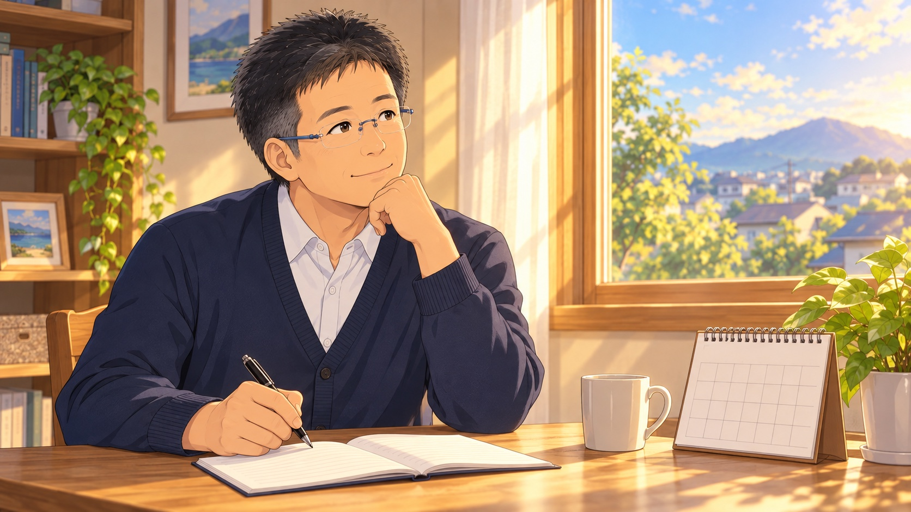

テロップ：これからの働き方を考えて。

読み上げ：定年後の収入のことも、考えていました。

演出：カレンダーとノート。妻や家族の発言は創作して本人証言に混ぜない。

根拠・確認：会議28:35。個人的な金額や非公開の職場事情は不要。

## 03-08｜26–30秒｜セミナー会場に入る・足元から引き

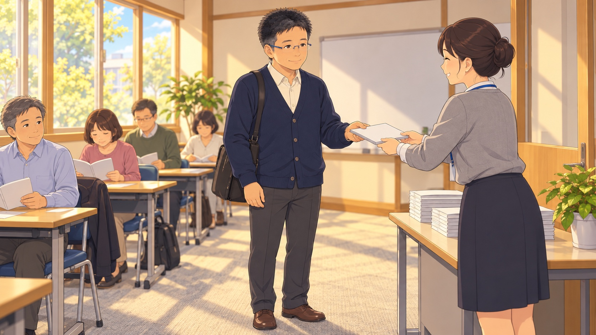

テロップ：まずは、セミナーへ。

読み上げ：そこで、セミナーに参加し始めました。

演出：受付資料を受け取り、学ぶ側の一歩を描く。会場にNoriの看板は付けない。

根拠・確認：会議28:35／37:13〜38:16。Noriが全課程を開催する表現にしない。

## 03-09｜30–34秒｜骨格図を学ぶ・肩越し

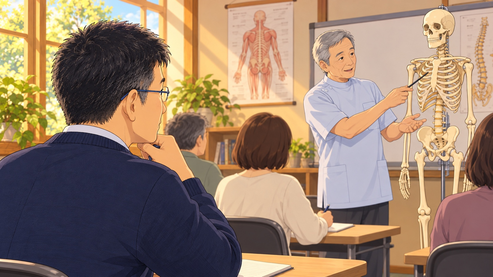

テロップ：からだの仕組みを学ぶ。

読み上げ：体の仕組みや、

演出：講師と骨格模型を見つめる先生。体の構造を学ぶ内容のイメージ。

根拠・確認：全健会セミナーの一般内容。具体的な受講風景は再現。

## 03-10｜34–38秒｜実技を見学する・広角

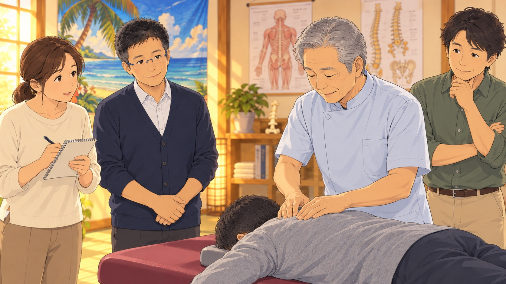

テロップ：手技を学ぶ。

読み上げ：手技を学んでいく。

演出：成人受講者2〜3名。講師の動作を見て、先生がうなずく。

根拠・確認：公式セミナーの内容を参考。資格認定そのものを描かない。

## 03-11｜38–42秒｜右手でメモ、左手でノート固定

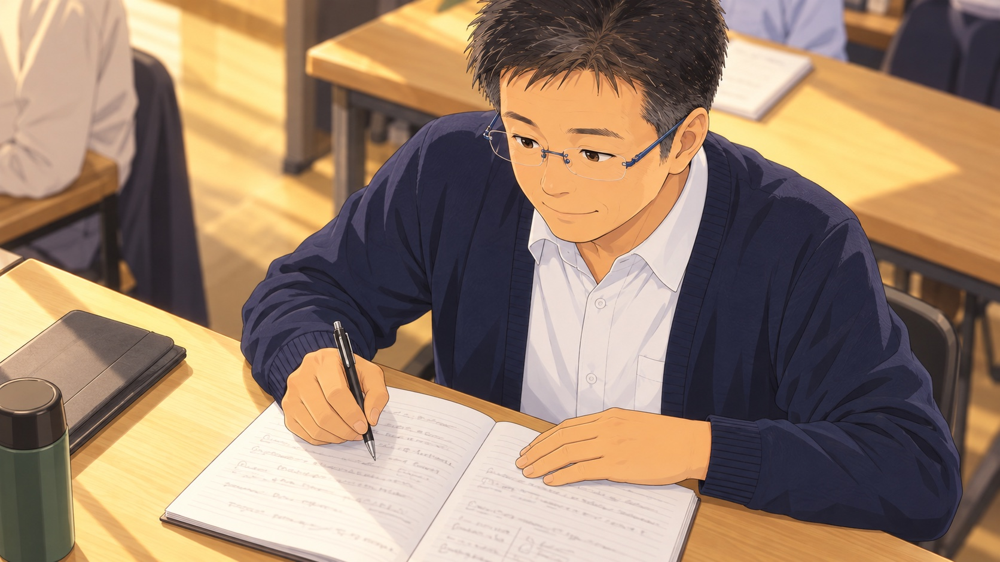

テロップ：一つずつ、積み重ねる。

読み上げ：学びを、一つずつ積み重ねました。

演出：手元を斜め上から。右手のペンと左手の位置を一枚ずつ検品。

根拠・確認：受講事実の範囲の語り案。架空の合格証や期間の断定を入れない。

## 03-12｜42–46秒｜私服から白い制服の現在へ

テロップ：そして、仕事という選択へ。

読み上げ：そして今、施術を仕事にしています。

演出：同じ顔・同じ構図で現在へ。老若の差を大きく付けない。

根拠・確認：会議38:16／開院投稿2026年9月。収入実績は示さない。

## 03-13｜46–50秒｜現在のNori院・先生が迎える

テロップ：Nori施術院　前田 宗紀

読み上げ：Nori施術院の、前田です。

演出：実際の院内と成熟した先生。店名を明確に。

根拠・確認：提供写真・Googleマップ。

## 03-14｜50–54秒｜解剖図を見て考える成人・別人物

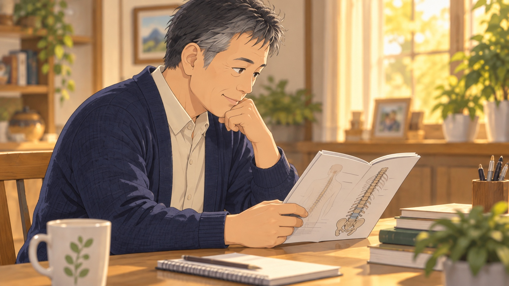

テロップ：自分のからだを、もっと知りたい。

読み上げ：自分の体のことを、もっと知りたい方。

演出：ここから視聴者への案内。先生の過去再現を終え、字幕色で区別。

根拠・確認：会議25:22の参加理由の例。先生本人の入門動機とは書かない。

## 03-15｜54–58秒｜家族の話を聞く成人・家庭

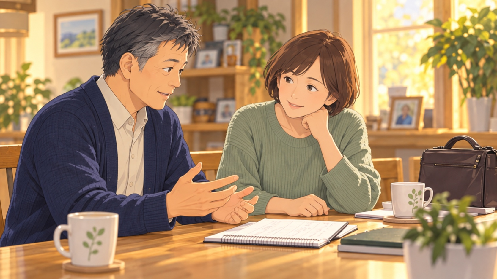

テロップ：家族の健康に、関心がある。

読み上げ：家族の健康に、関心がある方。

演出：二人が座って体調を気遣う会話。家族への施術や治療の保証は描かない。

根拠・確認：会議25:22。家族の症状改善や医療費削減は断定しない。

## 03-16｜58–62秒｜仕事のノートを開く成人

テロップ：副業や、これからの仕事に。

読み上げ：副業や、これからの仕事を考える方にも。

演出：「これからの仕事」「学ぶこと」の2項目。売上・利益のグラフは出さない。

根拠・確認：会議22:47〜25:22。資格・就業・収入の保証はしない。

## 03-17｜62–66秒｜先生と相談者・対面の全景

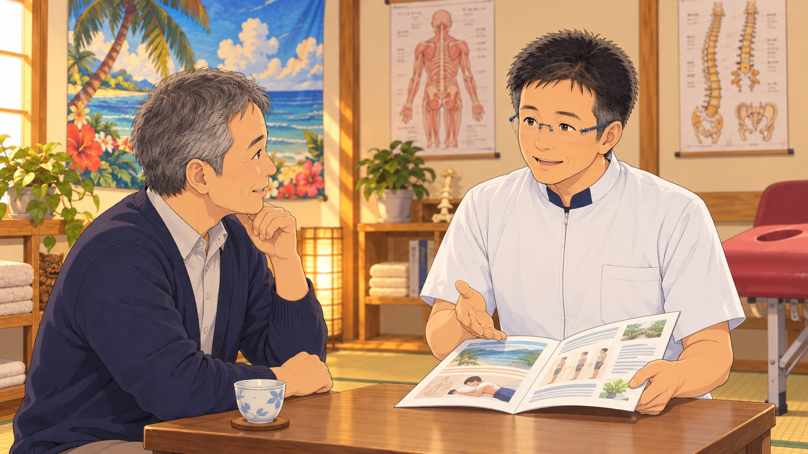

テロップ：まずは、話を聞くところから。

読み上げ：まずは、私に話を聞きに来ませんか。

演出：相談者が質問し、先生が資料を示す。高解像度の単独画像で制作。

根拠・確認：会議23:23〜26:43。本人は学び先を紹介する役割。

## 03-18｜66–70秒｜学び方を説明する資料の手元

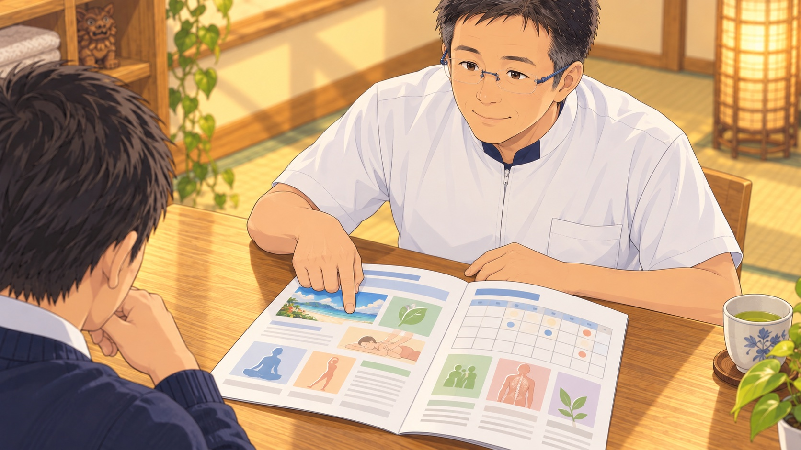

テロップ：学び方・費用・日程をご相談

読み上げ：学び方や参加先について、ご案内します。

演出：学ぶ内容・会場・費用・日程の見出しだけを表示。未確定の数字を作らない。

根拠・確認：会議24:18〜26:43。説明会の確定日時・会場はまだ未確認。

## 03-19｜70–74秒｜先生正面と検索窓

テロップ：一生使える技術で、新しい仕事に挑戦。

読み上げ：カイロプラクティックを、学んでみませんか。

演出：先生の年齢感を顔写真2・3で照合。検索語を編集で正確に重ねる。

根拠・確認：ユーザー採用済みのCTA方向。保証文ではなく学びへの呼びかけ。

## 03-20｜74–80秒｜同じCTA内の電話番号を強調

テロップ：「カイロの説明を聞きたい」とお電話ください。

読み上げ：「カイロの説明を聞きたい」と、お電話ください。

演出：19から検索窓を保持し、電話番号と問い合わせ文を追加。合計10秒のCTA。

根拠・確認：090-3386-2986／Nori施術院 知多市。19→20は読みやすさのため意図的にCTAを保持。
