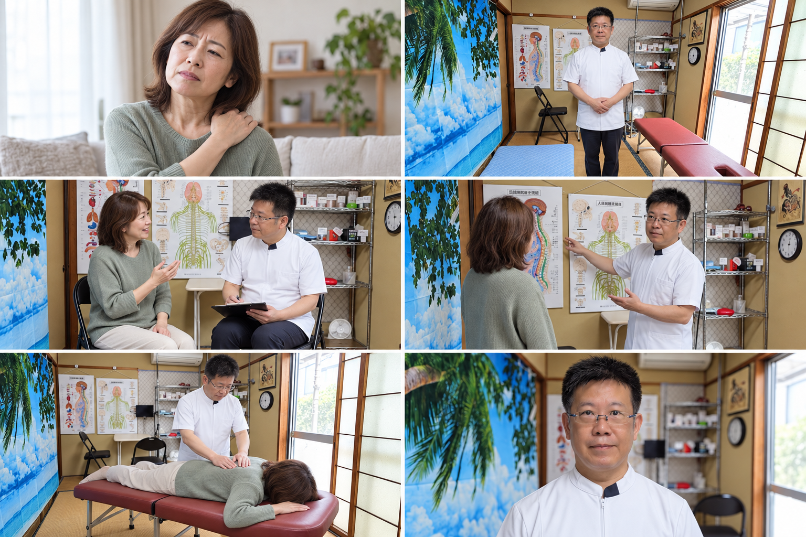
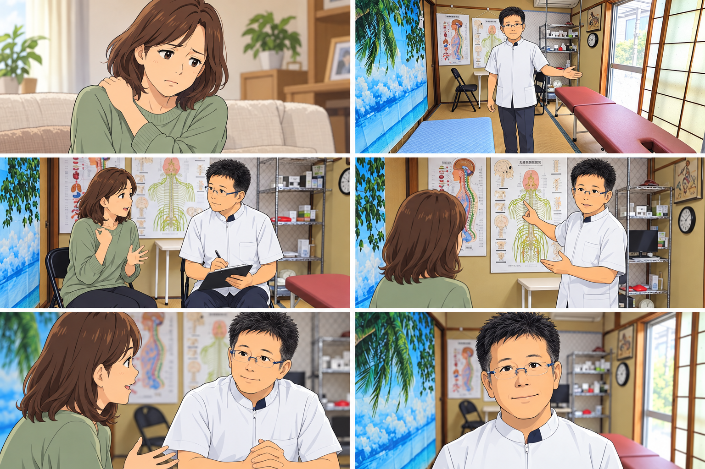
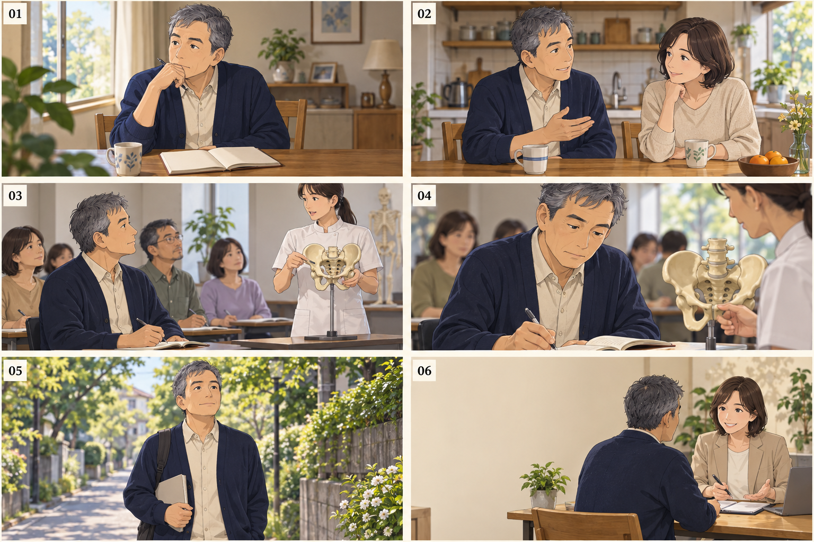

# Nori施術院｜構成案 v2

各30秒・横長16:9は提案値です。未承認の静止画モックアップです。

## 01｜まずは、話してみませんか。

**実写風・店舗紹介**

目的：近隣の方に、先生の人柄と相談しやすさを伝える。

対象：近隣の中高年を中心に、肩・腰や姿勢が気になる方

| シーン | 時間 | 内容 | 映像・動き |
|---|---|---|---|
| 01 | 0–4秒 | 日常の気がかり | 自宅で肩に手を添える女性。ゆっくり寄り、悩みに共感。 |
| 02 | 4–8秒 | 先生との出会い | 実際の畳の院内で先生がお迎え。海の壁掛け・障子・ベッドを見せる。 |
| 03 | 8–13秒 | まず、お話から | 目線の高さを合わせた対話。先生の表情と相づちを見せる。 |
| 04 | 13–18秒 | 骨盤・姿勢に目を向ける | 実際の壁面の人体図を使った説明イメージ。説明の内容は先生確認。 |
| 05 | 18–24秒 | 落ち着いた施術イメージ | 大きくひねる動きや強い音は使わない。手の位置・技法は先生確認。 |
| 06 | 24–30秒 | 相談へつなぐ | 先生を右、院名と連絡先を左。最後は6秒確保して読める設計。 |

## 02｜身近な場所で、からだの相談。

**アニメ・店舗紹介**

目的：生活の中の悩みと来院の流れを、やわらかく描く。

対象：初めてのカイロに少し不安がある、地域の幅広い世代

| シーン | 時間 | 内容 | 映像・動き |
|---|---|---|---|
| 01 | 0–4秒 | 家事の合間に | 家事の手を止める女性。痛みの誇張より、日常の小さな気がかり。 |
| 02 | 4–8秒 | 相談する一歩 | 実際の和室の院内を見せる。畳・海の壁掛け・赤茶色ベッドをアニメ化。 |
| 03 | 8–13秒 | やさしい迎え入れ | 先生の眼鏡・髪型・白い制服をアニメ化。奥の折り畳み椅子でお話を伺う。 |
| 04 | 13–18秒 | わかりやすく伝える | 実際の壁面の人体図を使い、先生と相談者の会話で説明を見せる。 |
| 05 | 18–24秒 | 不安を話せる時間 | 相談中の表情を寄りで見せる。施術効果のビフォーアフターにはしない。 |
| 06 | 24–30秒 | 地域の相談先として | 院名と連絡先を大きく表示。先生のアニメ化は本人確認後に統一。 |

## 03｜学ぶことから、新しい一歩。

**フルAIアニメ・学びの入口**

目的：自分や家族の健康への関心を、学びの相談につなげる。

対象：自分・家族の健康、将来の働き方や副業に関心がある方

| シーン | 時間 | 内容 | 映像・動き |
|---|---|---|---|
| 01 | 0–4秒 | これからを考える | 50代の架空の主人公がノートを開く。先生本人の経歴再現ではない。 |
| 02 | 4–8秒 | 家族への関心 | 夫婦の自然な会話。家族への無資格施術を推奨する描写は入れない。 |
| 03 | 8–13秒 | カイロを知る | 学ぶ場のイメージ。Nori施術院が資格を発行するようには見せない。 |
| 04 | 13–18秒 | 学びに向き合う | 受講・ノート・模型の寄り。実在する講座や会場の再現ではない。 |
| 05 | 18–24秒 | 将来の選択肢 | ノートを手に歩く主人公。収益・資格取得・開業の成功は約束しない。 |
| 06 | 24–30秒 | 相談窓口を明確に | 背景の人物は相談イメージ。連絡先を前面に置き、案内窓口を明確に。 |
